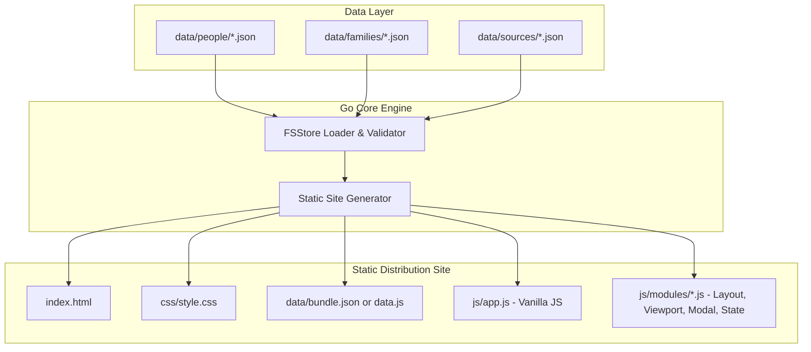
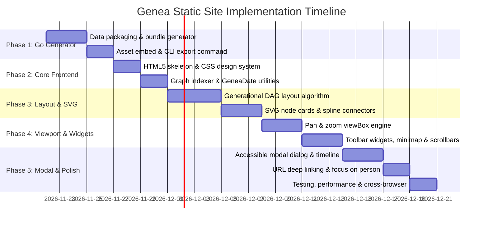

# Implementation Plan: Genea Static Interactive Tree Viewer

**Document:** `spec/static_plan.md`  
**Status:** Proposed Architecture & Implementation Plan  
**Target Architecture:** 100% Static Web Application, Vanilla Modern JavaScript (ES6+), Zero-Runtime Backend, High-Performance SVG Rendering

---

## 1. Executive Summary & Design Principles

The Genea Static Tree Viewer is a standalone, read-only web application generated directly from the Genea archive repository. It renders the entire genealogy network as an interactive, performant SVG tree with smooth panning, multi-level zooming, generational navigation, scrollbars, and a detail inspection modal.

### Core Principles
1. **Zero Runtime Backend & Static Serving:** Purely static HTML, CSS, JavaScript, and SVG/JSON assets. The site can be hosted on GitHub Pages, Cloudflare Pages, Amazon S3, any static web server, or viewed locally via a lightweight file server or `file://` protocol.
2. **Longevity & Zero Framework Churn:** Built strictly with modern vanilla JavaScript (ES modules), semantic HTML5, and standard CSS3. No Node.js build step, bundler runtime, or heavy third-party graph dependencies (e.g. D3, Cytoscape, GoJS) are required to run the site.
3. **High-Performance Direct Manipulation:** Supports fluid 60fps pan, zoom, drag, and scrollbar navigation across hundreds or thousands of nodes using SVG coordinate transformations (`viewBox` manipulation) and hardware-accelerated CSS.
4. **Rich Information Architecture:** Every individual in the tree displays core vital dates (name, birth, death) directly on their node, while selecting a node opens a comprehensive modal popup displaying their full biographical record, life event timeline, family links, sources, and notes.

---

## 2. High-Level Architecture & Workflow



### Static Site Generation Flow
1. **Validation:** Go CLI executes `FSStore.ValidateAll()` ensuring graph integrity before export.
2. **Bundle Generation:** The generator compiles all people, families, and sources into a structured data bundle (`dist/data.json` and optionally `dist/data.js` as `window.GENEA_DATA` to support local file browsing without CORS issues).
3. **Asset Assembly:** The generator outputs HTML, CSS, and modular ES6 JavaScript files into the output directory (e.g. `dist/` or `site/`).

---

## 3. Directory Layout

The generated static web application will follow this layout:

```text
genea/
├── spec/
│   ├── spec.md                 # System specification
│   └── static_plan.md          # This static web viewer plan
├── internal/
│   └── site/                   # Go static site generator package
│       ├── generator.go        # Site generation orchestration
│       ├── templates/          # Embedded HTML/CSS/JS templates
│       └── bundle.go           # Data packaging & graph pre-indexing
└── web/ (source templates for dist)
    ├── index.html              # Main HTML5 application shell & dialogs
    ├── css/
    │   ├── main.css            # Base styles, CSS variables, typography
    │   ├── tree.css            # SVG styles, node cards, connection edges
    │   ├── controls.css        # Floating toolbar, zoom/pan widgets, minimap
    │   └── modal.css           # Person detail modal dialog & timeline
    └── js/
        ├── app.js              # Application entrypoint & initialization
        ├── state.js            # URL hash router, selection state, history
        ├── graph-store.js      # In-memory graph index & relationship queries
        ├── layout/
        │   ├── tree-layout.js  # Genealogy DAG layout & coordinate engine
        │   └── bezier.js       # Orthogonal & curved SVG connector paths
        ├── viewport/
        │   ├── svg-viewport.js # ViewBox transform, wheel zoom, pointer drag
        │   ├── scrollbars.js   # Synchronized virtual scrollbars
        │   └── controls.js     # Toolbar widgets (+, -, reset, pan arrows)
        ├── components/
        │   ├── node-card.js    # SVG node rendering template
        │   └── person-modal.js # HTML5 <dialog> modal controller
        └── utils/
            ├── date-format.js  # GeneaDate formatting (exact, about, between)
            └── dom.js          # DOM & SVG element builders
```

---

## 4. Tree Layout & SVG Rendering Engine

Genealogical graphs are Directed Acyclic Graphs (DAGs) with distinct topologies: couples form spousal units, parents share children, and individuals can marry across branches.

### 4.1 Layout Approaches Considered

| Approach | Advantages | Trade-offs | Recommendation |
| :--- | :--- | :--- | :--- |
| **A. Pure Go SVG Pre-calculation** | Instant zero-JS paint; static SVG can be pre-rendered directly into HTML. | Dynamic branch expansion or switching focus requires regenerating or static rendering of entire tree at once. | Pre-index coordinates or provide hybrid fallback. |
| **B. Client-Side Vanilla JS DAG Layout** | Dynamic focus switching (Hourglass, Ancestors-only, Descendants-only); responsive node repositioning. | Computes coordinates on initial page load in client JS. | **Chosen Primary:** Extremely responsive, flexible, and keeps bundle compact. |

### 4.2 Layout Views Supported by `tree-layout.js`
1. **Hourglass Lineage View (Default Focus):**
   - Centers on a chosen root person (or the earliest root).
   - Direct ancestors expand upwards; direct descendants expand downwards.
   - Spouses are placed horizontally adjacent with a family connector node between them.
2. **Full Family Network / Generational Tier View:**
   - Computes generational ranks $Y = \text{generation} \times \text{tierHeight}$.
   - Groups married couples into family pods $(X_{\text{partner1}}, X_{\text{partner2}})$.
   - Connects parent pods to children with orthogonal step-connectors or cubic Bézier splines.

### 4.3 Node Dimensions & SVG Presentation
* **Card Dimensions:** $220\text{px}$ width $\times 84\text{px}$ height.
* **Vertical Tier Gap:** $140\text{px}$ between generational levels.
* **Horizontal Spacing:** $32\text{px}$ between individual nodes; $64\text{px}$ between distinct family clusters.
* **Node Content:**
  - **Full Name:** Given name and surname (with maiden/birth name if present). Truncated with ellipsis if exceeding available width.
  - **Birth Date:** Marked with `*` or `b.`, formatted with qualifier (e.g. `* 16 Sep 1892`, `* abt. 1850`).
  - **Death Date / Status:** Marked with `†` or `d.`, formatted with qualifier (e.g. `† 06 Mar 1980`). If `living: true`, displayed as `Living`.
  - **Visual Badging:** Subtle left accent bar reflecting sex (male: steel blue `#3b82f6`, female: terracotta/rose `#ec4899`, unknown/other: slate `#64748b`).
* **Connection Edges:**
  - SVG `<path>` elements with CSS classes `.edge-marriage` and `.edge-child`.
  - Orthogonal elbow routing or cubic Bézier curves:
    $$\text{path} = M(x_1, y_1) \ C(x_1, \frac{y_1 + y_2}{2}, x_2, \frac{y_1 + y_2}{2}, x_2, y_2)$$

---

## 5. Viewport, Pan, Zoom & Navigation Widgets

Large genealogy trees easily exceed $5,000 \times 3,000$ pixels. A multi-layered navigation system ensures effortless traversal:

```text
┌────────────────────────────────────────────────────────────────────────┐
│  Genea Archive Viewer                    [ Focus on Person... 🔍 ] [⚙] │
├────────────────────────────────────────────────────────────────────────┤
│                                                                 ▲      │
│   ┌─────────────────────────────────────────────────────────┐   │      │
│   │ [●] Andreas Kristian Høy                          [♂]   │   │      │
│   │ ─────────────────────────────────────────────────────── │   │      │
│   │ * 16 Sep 1892 (Snorom kro)                              │   │      │
│   │ † 06 Mar 1980 (Århus)                                   │   │      │
│   └───────────────────────────┬─────────────────────────────┘   │      │
│                               │                                 │      │
│                         ┌─────┴─────┐                           │      │
│                         │  Family   │                           │      │
│                         └─────┬─────┘                           │      │
│                               │                                 ▼      │
│   ◄───────────────────────────┼─────────────────────────────► [Scroll] │
│                                                                        │
│  [Minimap]                                            [Floating Tools] │
│  ┌──────────┐                                         ┌──────────────┐ │
│  │ ┌──┐     │                                         │ [▲] [▼] [◀][▶]│
│  │ └──┘     │                                         │ [+] Zoom In  │ │
│  └──────────┘                                         │ [-] Zoom Out │ │
│                                                       │ [⛶] Fit All  │ │
│                                                       │ [⌖] Center   │ │
│                                                       └──────────────┘ │
└────────────────────────────────────────────────────────────────────────┘
```

### 5.1 SVG ViewBox Pan & Zoom Mechanics
- The entire tree renders within a single master `<svg>` container.
- Pan and zoom are applied by updating the SVG `viewBox="minX minY width height"`, avoiding CSS transform blur and maintaining razor-sharp vector text at any zoom level.
- **Zoom Range:** $0.1\times$ to $3.0\times$.
- **Pointer Drag:** Smooth drag-to-pan using Pointer Events (`pointerdown`, `pointermove`, `pointerup`) with hardware acceleration and inertial momentum.
- **Wheel Zoom:** Centered zoom around the cursor position for natural mouse interaction.
- **Pinch-to-Zoom:** Native two-finger pinch gesture support on touch devices.

### 5.2 UI Widgets (Controls Toolbar)
1. **Directional Pan Buttons:** Up, Down, Left, Right buttons for stepped keyboard/touch scrolling.
2. **Zoom In (`+`) & Zoom Out (`-`):** Stepped 20% zoom increments.
3. **Zoom Level Indicator:** Current percentage (e.g. `100%`) with click-to-reset.
4. **Fit to Screen (`⛶`):** Calculates the bounding box of all rendered nodes and adjusts the `viewBox` with a 40px margin.
5. **Center on Selected Person (`⌖`):** Smoothly animates the viewport to center on the active person node.
6. **Minimap Navigator (Radar View):**
   - Miniature corner canvas displaying all node positions in low detail.
   - Transparent highlighted rectangle representing the current visible viewport.
   - Clicking or dragging the minimap rectangle immediately repositions the main tree.
7. **Focus on Person Input (`[ Focus on Person... 🔍 ]`):**
   - Search/filter input located in the top bar to locate individuals by name or ID.
   - **Automatic Navigation on Unique Match:** When the user has a unique match in the tree, the view automatically moves (smoothly pans and centers) to the matching person.

### 5.3 Integrated Scrollbars
- In addition to canvas drag-and-pan, the viewer implements synchronized scrollbar tracks on the bottom and right edges of the viewport.
- As the user pans or zooms, custom scroll thumbs update dynamically to indicate relative position and visible proportion.
- Dragging the scrollbar thumbs smoothly pans the SVG `viewBox`.

---

## 6. Person Selection & Detail Modal

### 6.1 Selection Interaction
- Clicking any person node card marks it as selected (`.node-card.selected`).
- Visual feedback: high-contrast outline glow, elevated drop shadow, and subtle highlighting of connected family edges.
- Updates browser URL hash: `#person=p_andreas_kristian_hoey`.
- Automatically opens the person details modal dialog.
- **Focus on Person:** When typing in the "Focus on Person" input yields a unique match in the tree, the view automatically moves to center on the matching person.

### 6.2 Modal Dialog Specifications (`components/person-modal.js`)
Uses the semantic HTML5 `<dialog id="person-dialog">` element for accessibility and native focus trapping.

```html
<dialog id="person-dialog" class="person-modal" aria-labelledby="modal-person-name">
  <div class="modal-content">
    <header class="modal-header">
      <div class="modal-title-group">
        <h2 id="modal-person-name">Andreas Kristian Høy</h2>
        <span class="badge sex-male">Male</span>
        <span class="badge status-deceased">Deceased</span>
      </div>
      <button class="modal-close-btn" aria-label="Close dialog">&times;</button>
    </header>

    <div class="modal-body">
      <!-- Section: Demographics & Names -->
      <section class="modal-section">
        <h3>Names & Identity</h3>
        <table class="details-table">
          <tr><th>ID</th><td>p_andreas_kristian_hoey</td></tr>
          <tr><th>Given Name</th><td>Andreas Kristian</td></tr>
          <tr><th>Surname</th><td>Høy</td></tr>
          <tr><th>Display Name</th><td>Andreas Kristian Høy</td></tr>
        </table>
      </section>

      <!-- Section: Life Events Timeline -->
      <section class="modal-section">
        <h3>Life Events Timeline</h3>
        <ol class="events-timeline">
          <!-- Dynamically populated events: birth, baptism, marriage, death, etc. -->
          <li class="event-item">
            <span class="event-type">Birth</span>
            <span class="event-date">16 Sep 1892 (exact)</span>
            <span class="event-place">Snorom kro, Danmark</span>
          </li>
          <li class="event-item">
            <span class="event-type">Death</span>
            <span class="event-date">06 Mar 1980 (exact)</span>
            <span class="event-place">Århus, Danmark</span>
          </li>
        </ol>
      </section>

      <!-- Section: Family Relationships -->
      <section class="modal-section">
        <h3>Family Relationships</h3>
        <div class="relations-grid">
          <div class="relation-card">
            <h4>Parents</h4>
            <ul id="modal-parents-list">
              <li><button class="link-person" data-id="p_father">Father Name</button></li>
              <li><button class="link-person" data-id="p_mother">Mother Name</button></li>
            </ul>
          </div>
          <div class="relation-card">
            <h4>Spouses & Partners</h4>
            <ul id="modal-spouses-list">
              <li><button class="link-person" data-id="p_valborg_moeller">Valborg Møller</button></li>
            </ul>
          </div>
          <div class="relation-card">
            <h4>Children</h4>
            <ul id="modal-children-list">
              <!-- Clickable children links with relationship type -->
            </ul>
          </div>
        </div>
      </section>

      <!-- Section: Notes & Sources -->
      <section class="modal-section">
        <h3>Notes & Sources</h3>
        <div id="modal-notes" class="modal-notes"></div>
        <ul id="modal-sources-list" class="sources-list"></ul>
      </section>
    </div>

    <footer class="modal-footer">
      <button class="btn btn-primary" id="btn-center-tree">Center in Tree</button>
      <button class="btn btn-secondary" id="btn-close-modal">Close</button>
    </footer>
  </div>
</dialog>
```

### 6.3 Inter-Modal Navigation
Clicking any relative (parent, spouse, child) inside the modal updates the modal contents immediately to that person and animates the background tree to center on the new individual.

---

## 7. Implementation Roadmap & Milestones



### Phase 1: Go Site Generator & Data Pipeline
- Implement `internal/site/generator.go` and `internal/site/bundle.go`.
- Add `-export-web <dir>` flag to `main.go`.
- Validate data via `FSStore.ValidateAll()` before export.
- Bundle `people`, `families`, and `sources` into clean JSON (`dist/data.json` and `dist/data.js`).

### Phase 2: HTML5 Shell, CSS & Graph Store
- Build semantic `index.html` structure (header with "Focus on Person" input, viewport canvas, floating widgets, dialog).
- Implement `css/main.css` and `css/tree.css` with responsive CSS variables, light/dark themes, and crisp typography.
- Implement `js/graph-store.js` for fast index queries: `getPerson(id)`, `getFamily(id)`, `getParents(id)`, `getChildren(id)`, `getSpouses(id)`.
- Implement `js/utils/date-format.js` handling all GeneaDate formats and qualifiers.

### Phase 3: Tree Layout Engine & SVG Generator
- Implement `js/layout/tree-layout.js`:
  - Calculate generational depth ranks.
  - Position family units and spouse pairs.
  - Route connector paths between parents and children.
- Implement `js/components/node-card.js`:
  - Render SVG `<g>` elements with name, birth date, death date, and sex badging.
  - Ensure SVG text scales cleanly without distortion.

### Phase 4: Interactive Viewport, Navigation Widgets & Scrollbars
- Implement `js/viewport/svg-viewport.js`:
  - Pointer event handlers for drag-to-pan.
  - Wheel event handlers for cursor-centered zooming.
  - ViewBox transform animations.
- Implement `js/viewport/controls.js`:
  - Zoom in/out, fit-to-screen, and directional pan widgets.
  - Minimap canvas showing visible viewport bounding box.
- Implement `js/viewport/scrollbars.js`:
  - Virtual synchronized scrollbar sliders for horizontal and vertical panning.

### Phase 5: Person Selection, Detail Modal & URL Deep Linking
- Implement `js/components/person-modal.js`:
  - Native `<dialog>` behavior with keyboard `Escape` closing.
  - Full life events timeline, formatted places, descriptions, and citations.
  - Clickable relative buttons with instant tree refocusing.
- Implement `js/state.js`:
  - Synchronize selection with URL hash (`#person=p_id`).
  - Support browser back/forward navigation.
  - Implement "Focus on Person" input with autocomplete dropdown; when user has a unique match in the tree, the view automatically moves to the matching person.

### Phase 6: Validation, Performance & Edge Cases
- Verify handling of complex genealogies:
  - Unmarried parents, multiple marriages/spouses, unknown birth/death dates, living individuals.
- Performance verification:
  - Ensure smooth 60fps pan/zoom with 200+ nodes.
  - Test offline execution via `file://` and local web server.
- Write documentation and user guide.

---

## 8. Verification & Acceptance Criteria

1. **Static Independence:** Output in `dist/` contains solely static files (`.html`, `.css`, `.js`, `.json`). Can be hosted anywhere without server-side processing.
2. **SVG Tree Rendering:** All people and families in the dataset render cleanly in SVG with proper generational alignment and clear relational edges.
3. **Node Display:** Every node clearly shows:
   - Name (display name or given + surname)
   - Date of birth (with qualifier if present)
   - Date of death (or living indicator)
4. **Navigation:**
   - Zoom in/out widgets operate smoothly.
   - Directional pan buttons move the view.
   - Native/virtual scrollbars reflect position and allow dragging.
   - Drag-to-pan and mouse wheel zoom work fluidly.
5. **Selection & Modal:**
   - Clicking a node highlights it and opens the modal popup.
   - Modal displays complete data: all names, sex, living status, events with full dates/places/descriptions/sources, parent/spouse/child links, notes.
   - Clicking family links inside the modal transitions to the selected relative.
6. **Focus on Person:**
   - "Focus on Person" input filters matches in real time.
   - When the user has a unique match in the tree, the view automatically moves to center on the matching person.
7. **Code Standards:** 100% vanilla modern JavaScript (ES6+ modules), zero npm dependencies, semantic HTML, and clean Go standard library code.
